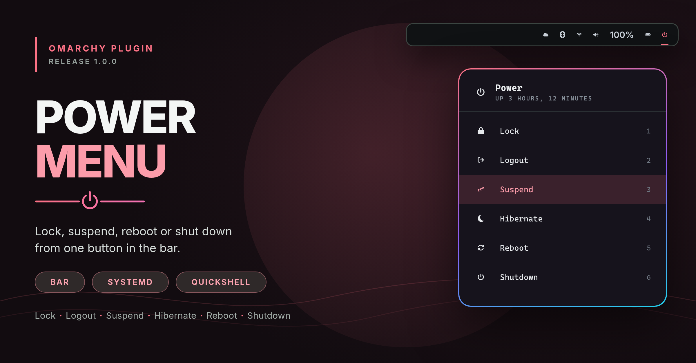

# Power Menu for Omarchy



A power button for the Omarchy bar. Click it to open a popup with the system uptime in the header and these actions:

| # | Action    | Command                   |
|---|-----------|---------------------------|
| 1 | Lock      | `omarchy-system-lock`     |
| 2 | Logout    | `omarchy-system logout`   |
| 3 | Suspend   | `systemctl suspend`       |
| 4 | Hibernate | `systemctl hibernate`     |
| 5 | Reboot    | `omarchy-system reboot`   |
| 6 | Shutdown  | `omarchy-system shutdown` |

- **Suspend** is hidden when you've turned suspend off in Omarchy.
- **Hibernate** only shows when hibernation is set up (`omarchy-hibernation-available`).
- **Logout**, **Reboot** and **Shutdown** ask for confirmation first. In the
  dialog, `Left`/`Right`/`Tab` switch buttons, `Enter` picks the highlighted
  one (the action itself is highlighted by default) and `Esc` cancels.
- Keyboard: the first arrow, `j`/`k` or `Enter` press only shows the cursor.
  After that, arrows or `j`/`k` move, `Enter` selects and `Esc` closes.
  `Tab` switches to the next bar panel.
- The number keys pick a row directly (`1` is the first row shown). Hidden rows
  are not counted, so the numbers shift when Suspend or Hibernate is hidden. A
  number key runs the action at once, or opens the confirmation for the three
  above.
- The button allows only one instance on the bar.

## Requirements

- Omarchy 4 (the Quickshell-based `omarchy-shell` bar)
- An Omarchy release that ships the `omarchy-system` command (used for logout,
  reboot and shutdown)
- Nothing else to install: it uses `omarchy-system`, `omarchy-system-lock`,
  `systemctl` and the Nerd Font icons that ship with Omarchy

## Install

```bash
omarchy plugin add https://github.com/alshareedah22/omarchy-power-menu.git --enable
```

The button is added to the right section of the bar. Move it anywhere with
`omarchy bar move`.

## Remove

```bash
omarchy plugin remove blackcode.power-menu
```

The plugin keeps no files of its own outside its folder, so nothing else is left behind. If its entry stays in the bar layout in `~/.config/omarchy/shell.json`, the bar shows nothing in that spot; you can delete the `{"id": "blackcode.power-menu", ...}` entry by hand.

## Update

```bash
omarchy plugin update blackcode.power-menu
```

## Settings

Both settings are keys on the widget's entry in `~/.config/omarchy/shell.json`.

`pinned` (default `false`) keeps the button at the far right edge of the bar,
even when other widgets are added later. It watches `shell.json` and runs
`omarchy bar move` to put the button back at the end of the right section. It
does nothing while the button is not on the bar:

```bash
omarchy bar set blackcode.power-menu pinned true --json
```

`confirm` (default `true`) controls the confirmation for logout, reboot and
shutdown. Set it to `false` to skip it:

```bash
omarchy bar set blackcode.power-menu confirm false --json
```

## License

MIT
